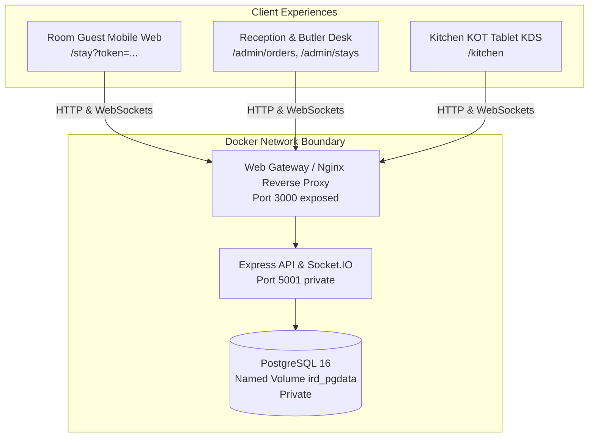
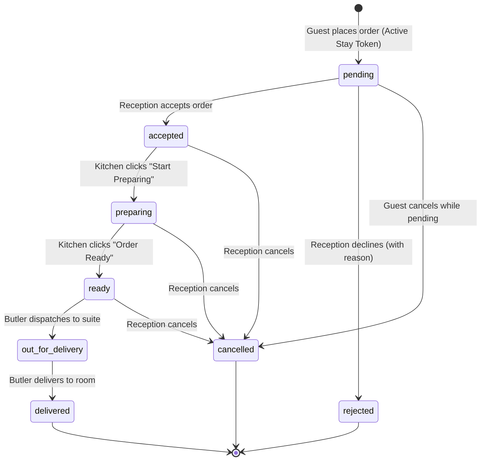

# Aura Resort & Spa · In-Room Dining (IRD) MVP

An independent, production-grade In-Room Dining (IRD) digital ordering and kitchen management system designed for luxury hotels and resorts.

---

## Architecture & Visual System

Designed with the **Aura Resort & Spa** warm neutral aesthetic:
- **Palette**: Warm ivory linen (`#F8F5EF`), deep roasted espresso (`#1E150F`), antique brass & caramel gold (`#B88223`), porcelain card surfaces (`#FFFDF9`).
- **Typography**: Editorial serif headings (`Playfair Display`), clean sans body (`Plus Jakarta Sans`), and monospaced timestamps & tokens (`JetBrains Mono`).
- **Stack**: React 19 + TypeScript + Vite 6 + TailwindCSS v4 on the frontend, Express + TypeScript + PostgreSQL 16 + Socket.IO on the backend, containerized via Docker Compose.



---

## 3 Role-Based Experiences

### 1. Room Guest
- **Room Identity via Active Stay Token**: Guests access in-room dining exclusively through a revocable stay token generated at check-in (e.g. `http://localhost:3000/stay?token=demo-stay-room-301`) or by entering their Suite number and 4-digit keycard PIN.
- **Server Authority**: The server never trusts client-submitted room numbers, item prices, or order status. The room number is pulled directly from the verified database stay record.
- **Mobile-First Luxury Menu**: Category filters (Breakfast, All-Day Dining, Late Night, Desserts, Beverages), instant search, and dietary chips (🌱 Vegetarian, 🌿 Vegan, 🌾 Gluten-Free, 🌶️ Spicy, ★ Chef's Signature).
- **Item Customization**: Support for choice of protein, bread type, sides, and guest preparation instructions.
- **Transparent Billing**: Clear breakdown of Culinary Subtotal, 10% Resort Tax, 5% Service Charge, and Total to Room Folio.
- **Live Order Status Tracking**: Realtime timeline progression (`Pending` → `Accepted` → `Preparing` → `Ready` → `En Route` → `Delivered`), with auto-reconnecting socket recovery and 5-second polling fallback.
- **Session Sharing**: Multiple guest devices in the same room sharing the QR code share the active stay context and see active room orders live.

### 2. Reception & Front Desk
- **Guest Stays & Room Credentialing**: Check in guests to rooms, auto-generate cryptographic stay tokens and 4-digit PINs, and generate live QR codes for room keycard sleeves.
- **Instant Revocation at Checkout**: Checking out a stay immediately revokes room access in realtime across all guest devices in that suite.
- **Live Order Queue**: Realtime feed grouped by room. Front desk staff can accept incoming orders, decline with explanation to guest, dispatch plated orders to butlers, or mark delivered.
- **Menu Catalog**: Instant 86-ing / availability toggle for out-of-stock items, price management, and dietary tag curation.
- **Settings & Audit Trail**: Configure property name, tax/service rates, currency, ordering hours, and review staff security audit logs.

### 3. Kitchen / KOT Display System
- **Tablet-Friendly High-Contrast KDS**: Large touch targets tailored for kitchen prep line tablets.
- **Actionable Tickets Only**: Only shows orders that require culinary action (`accepted`, `preparing`, `ready`).
- **Live Elapsed Ticking Timer**: Dynamic color-shifting timer (Green < 15 min, Amber 15-25 min, Red > 25 min) so chefs prioritize urgent tickets.
- **Synthesized Audio Alert**: Two-tone luxury audio chime synthesized in real time via the Web Audio API (zero external sound file dependencies) whenever a new order arrives.
- **Role Isolation**: Kitchen personnel can only advance tickets (`Start Preparing` → `Order Ready`). They cannot modify prices, view guest folios, or alter room access.

---

## Order Lifecycle State Machine



### Transition Authority Table

| From State | To State | Permitted Roles | Actions & Realtime Effects |
| :--- | :--- | :--- | :--- |
| `pending` | `accepted` | `staff`, `admin` | Sent to Kitchen KOT display; audio chime triggers |
| `pending` | `rejected` | `staff`, `admin` | Guest notified with cancellation rationale |
| `pending` | `cancelled` | `guest`, `staff`, `admin` | Order marked cancelled; no charge to folio |
| `accepted` | `preparing` | `kitchen`, `staff`, `admin` | Kitchen station timer starts ticking |
| `preparing` | `ready` | `kitchen`, `staff`, `admin` | Plated at pass; butler notified for pickup |
| `ready` | `out_for_delivery` | `staff`, `admin` | Butler en route to suite with warming cloche |
| `out_for_delivery` | `delivered` | `staff`, `admin` | Delivery confirmed |

---

## Default Seeded Accounts & Demo Rooms

### Staff Accounts (Bcrypt Hashed)

| Role | Username | Password | Access Scope |
| :--- | :--- | :--- | :--- |
| **General Manager (Admin)** | `admin` | `admin123` | Full access (Stays, Orders, Menu, Settings, Audit) |
| **Front Desk (Staff)** | `reception` | `staff123` | Stays checkin/checkout, Live Orders dispatch |
| **Executive Sous Chef** | `chef` | `kitchen123` | Kitchen KOT display only |

### Seeded Demo Guest Suite

- **Suite**: Room 301 (Royal Penthouse Suite · Ocean Panorama)
- **Guest Name**: Sir Alexander Wright
- **Guest PIN**: `4821`
- **Pre-generated Stay Token**: `demo-stay-room-301`
- **Direct Guest Access URL**: `http://localhost:3000/stay?token=demo-stay-room-301`

---

## Setup & Running Instructions

### Option 1: Docker Compose (Production-Parity)

Prerequisites: Docker & Docker Compose.

```bash
# 1. Copy sample environment file
cp .env.example .env

# 2. Build and start containers in background
docker compose up --build -d

# 3. Access web application
open http://localhost:3000
```

Only port `3000` is exposed to your machine. PostgreSQL and the Express backend remain private on the internal Docker network. Database data is safely persisted in the named volume `ird_resort_pgdata`.

---

### Option 2: Local Development Run

Prerequisites: Node.js 20+ and a local PostgreSQL instance (or Docker Postgres).

#### 1. Backend

```bash
cd backend

# Copy env
cp ../.env.example .env

# Run database migrations & seeds
npm run migrate

# Start backend server in watch mode (Port 5001)
npm run dev
```

#### 2. Frontend

```bash
cd frontend

# Start Vite dev server (Port 3000, proxies /api and /socket.io to 5001)
npm run dev
```

Open `http://localhost:3000` in your browser.

---

## Running Automated Tests

A focused test suite covering authorization, room access token security, order state machine rules, and tax/modifier calculations is included.

```bash
cd backend
npm test
```

### Verified Test Cases:
- `Staff Authentication & Authorization`: Bcrypt hash verification, JWT signing, role scopes, tampered token rejection.
- `Stay & Room Access Security`: Cryptographic token generation, 4-digit PIN verification, room order number formatting, signed guest tracking tokens.
- `Order State Machine & Role Permissions`: Reception transitions, illegal state transition prevention, strict kitchen role confinement, and guest pending-only cancellation.
- `Pricing, Taxes & Modifiers Calculation`: Subtotal with modifiers, 10% tax, 5% service charge, and floating-point cent rounding.

---

## Troubleshooting & FAQ

1. **"Stay access has expired or was revoked at checkout"**
   - When front desk checks out a room in `/admin/stays`, any open browser tab in that suite will immediately receive a `stay:invalidated` WebSocket event and revoke local ordering credentials. To order again, check in a new stay or use the demo room access link.
2. **Realtime socket shows "Reconnecting..."**
   - The frontend automatically switches to a 5-second polling fallback while continuing to attempt background WebSocket reconnects, ensuring guests and staff never lose state.
3. **Audio chime not playing in Kitchen KOT**
   - Modern browsers require at least one user interaction (click/touch) on the page before playing Web Audio API sound. Click the "Audio Chime ON" toggle on the kitchen console once to activate audio synthesis.
